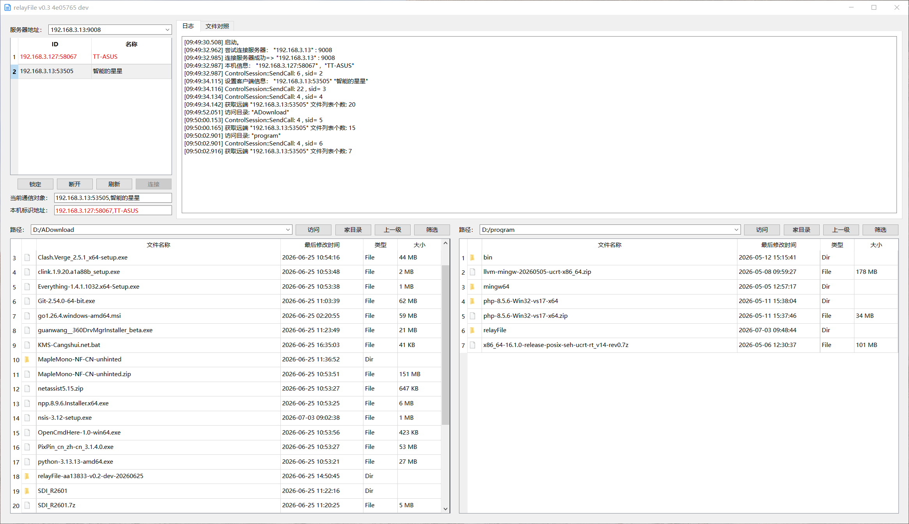
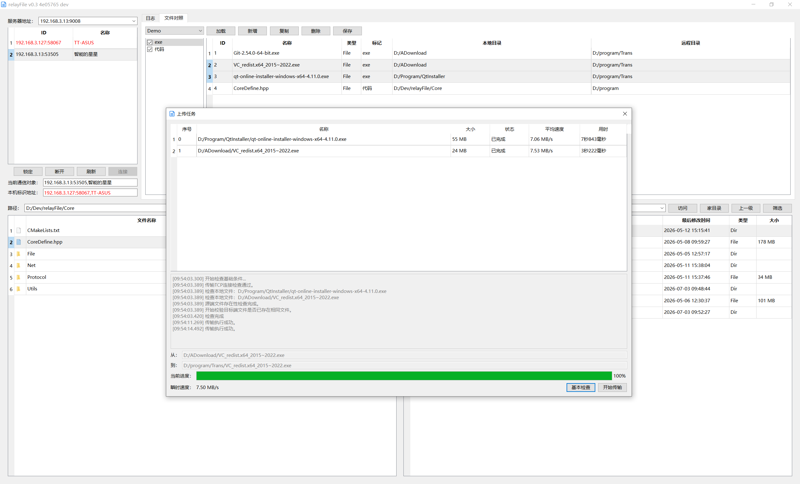
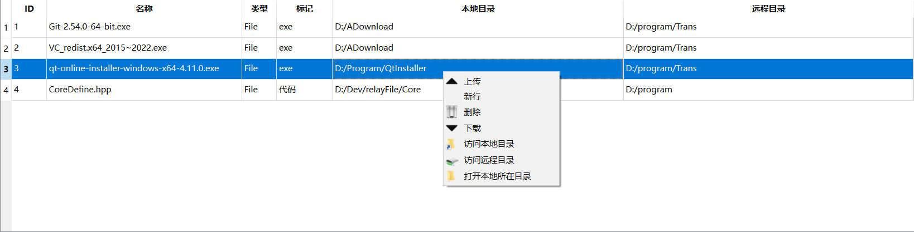
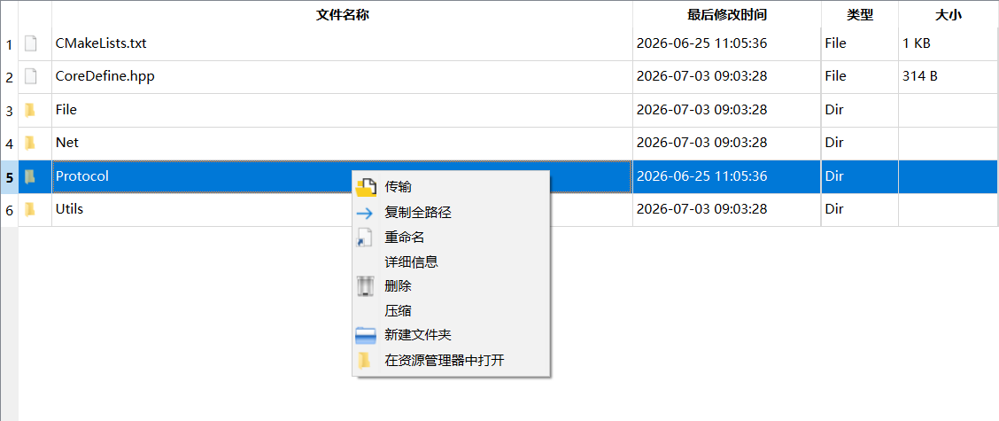
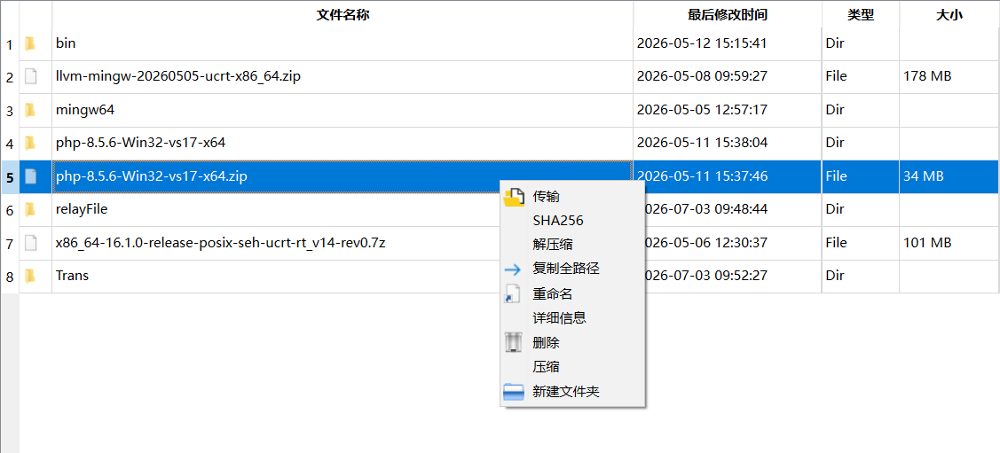
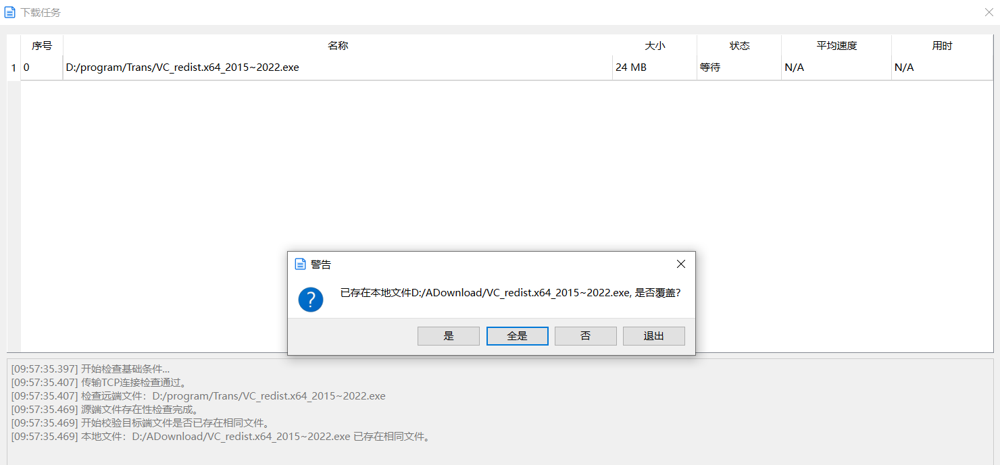

# relayFile

一个通过中继服务器在多个客户端之间相互传输文件的工具。

## 功能特点

1. 极简配置——只需启动服务器，连接至服务器，即可开始传输文件。
2. **提供本地-远程文件映射配置功能，支持一键传输，用于频繁传输相同的文件**（本工具开发主要初衷）。
3. 传输可靠——先落盘再应答、临时文件 + 原子重命名、完成握手，中断不会破坏目标位置的原文件。
4. 支持断点续传——同一文件重传时从已完成的偏移继续，不必从头再来。
5. 构建简单，只依赖 C++17 编译器和 `QtBase` 组件，依赖的其他三方外部代码均已内置。

## 组件

目前项目构建有三个二进制结果：

| 名称              | 类型  | 功能                                |
| --------------- | --- | --------------------------------- |
| relayFileServer | 控制台 | 中继服务器。                            |
| relayFileClient | 控制台 | 命令行客户端，没有操作功能，一般配合另外一个带GUI的客户端使用。 |
| relayFileGui    | GUI | GUI客户端。                           |

`ServerAlone/` 目录下另有一份基于 asio 的无 Qt 服务器实现，目前**尚未接入主构建**（`add_subdirectory` 未包含），可作为后续替换中继服务器的参考。

## 构建

依赖：CMake ≥ 3.16、C++17 编译器、Qt（控制台与核心库只需 `Core`/`Network`，GUI 另需 `Widgets`/`Sql`）。其余三方库（asio、cereal、fmt、spdlog、nlohmann/json、miniz、liblzma 等）都已在 `Third/` 内置，不需要额外安装。

MSYS2 / MinGW：

```bash
export PATH=/c/msys64/ucrt64/bin:$PATH
cmake -S . -B build -G Ninja -DCMAKE_BUILD_TYPE=Release \
      -DRF_USE_MINGW=ON -DCMAKE_PREFIX_PATH=C:/msys64/ucrt64
cmake --build build
```

MSVC：去掉 `-DRF_USE_MINGW=ON` 即可，Qt 路径按下面的预设自动选择。

| 选项 | 默认 | 说明 |
| --- | --- | --- |
| `RF_USE_GUI` | `ON` | 是否构建 GUI 客户端；关闭后只产出 Server/Client，不需要 Widgets/Sql |
| `RF_USE_MINGW` | `OFF` | 使用 MinGW 工具链，同时切换默认的 Qt 前缀路径 |
| `RF_BUILD_TESTS` | `OFF` | 构建 `Console/` 下的协议测试与压测程序（不进入发布产物） |
| `RELEASE_MARK` | 未定义 | 定义后版本号标记为 release，否则为 dev |

Qt 路径在 `CMakeLists.txt` 顶部按 `C:/Qt/6.10.3/{mingw_64,msvc2022_64}` 预设；安装位置不同时用 `-DCMAKE_PREFIX_PATH=<你的 Qt 目录>` 覆盖。

产物输出到 `build/bin/<配置>/`，静态库在 `build/lib/<配置>/`。

## 传输机制

- **控制连接与数据连接分离**：控制帧（路径、目录列表、哈希等）走长连接，文件体走独立 TCP 连接，互相不阻塞。
- **帧格式**：`RFM1` magic + 版本 + 帧长 + 头部 CRC32，单帧上限 32MB；小帧（≤64KB）额外带 body CRC。
- **字节滑动窗口**：默认在途 4MB，累积 ACK + 256 位 SACK 位图，只重传真正缺失的块；块大小（64KB / 256KB / 1MB）由接收方按文件大小协商。
- **先落盘再应答**：接收端写入成功后才回 ACK，写盘失败立即中断并通知对端。
- **不破坏原文件**：数据先写 `<目标>.relaypart`，收齐后校验长度再原子重命名，失败/中断不会留下半截目标文件。
- **断点续传**：用“总长度 + 首 64KB SHA-256”作为指纹，只复用块对齐的残片，指纹不符则丢弃重传。
- **可选加密**：AES-256-GCM 帧加密，开关在设置中；加密只用于防误读，不构成访问控制（见下方说明）。

## 性能

Release 构建、本机环回（中继服务器与收发端在同一台机器上，经 `127.0.0.1`）实测：

| 文件大小 | 耗时 | 吞吐 |
| --- | --- | --- |
| 2 MB | 34–42 ms | 48–59 MB/s |
| 200 MB | 0.80–0.93 s | 215–250 MB/s |
| 1 GB | 4.13–4.22 s | 243–248 MB/s |

测试环境与口径：

- AMD Ryzen 7 5800H / 32 GB / WD SN730 SSD / Windows 11；MSYS2 UCRT64 + GCC，`-DCMAKE_BUILD_TYPE=Release`（`-O3`）。
- 每个用例传完都用 SHA-256 比对收发两端，结果一致；上表为多次运行的区间（2MB/200MB 各 3 次，1GB 2 次）。
- 环回意味着不经过真实网络，测的是传输引擎本身的上限；实际速度取网络带宽与磁盘的较小值。
- 小文件耗时主要花在握手往返上，2MB 以下的吞吐参考意义有限。

复现（`-DRF_BUILD_TESTS=ON` 编译出压测程序）：

```bash
relayFileTransTest server                              # 中继服务器，端口 9108
relayFileTransTest receiver /path/target 209715200     # 接收端，等文件收齐后退出
relayFileTransTest sender /path/source /path/target    # 发送端，输出 cost/speed
```

## 目录结构

```
Core/       协议、网络会话、文件操作、压缩、加密
  Protocol/   帧编解码与消息定义
  Net/        控制/数据会话、中继服务器、传输引擎
  File/       本地文件与目录操作、压缩包读写
Gui/        Qt Widgets 界面
Console/    中继服务器与命令行客户端（测试程序也在这里）
ServerAlone/  asio 版中继服务器（未接入构建）
Third/      内置三方库
docs/       评审与设计文档
```

## 其他

从`v0.4`版本开始，功能优化和新增主要由AI进行维护。

`relayFile`是 [frelay传输工具 (XP支持)](https://github.com/taynpg/frelay) 的重新整理优化版本并去除了XP支持，以便可以更好的使用新标准和语法。

`relayFile`是跨平台的，由于Linux环境难以统一，仅预编译Windows版本，`v1.0`及其以后会编译流行Linux发行版包。

主要优化内容：

- 1.控制链接和传输链接分开处理，避免网络阻塞时控制消息排队难以到达的问题。
- 2.传输改用按字节的滑动窗口 + 累积应答 + SACK 选择性重传，双方带宽不一致时不会把数据堆在中继服务器上。
- 3.去除一些麻烦的构建依赖和配置。
- 4.使用新C++标准，对代码结构和写法进行整体优化，层次更清晰，更易于维护。
- 5.文件对照部分优化筛选逻辑。
- 6.更丰富便捷的功能。

## 警告与说明

本工具仅设计用于通过中继服务器在客户端之间进行简单的文件传输，未包含可防范数据攻击或类似威胁的安全验证逻辑，主要适用于临时性、非敏感的文件传输场景。请在不使用时及时关闭软件或断开与中继服务器的连接。

加密功能只用于防止传输内容被随手看到，**不构成身份认证或访问控制**：服务器不校验客户端身份，帧内的来源标识由发送方自行填写，未加密的帧也会被正常接收。

**本软件可能存在意外错误或者BUG，尤其是未达到`v1.0`版本之前，可能导致文件损坏或丢失。** 请务必做好文件备份，或仅将其用于非关键文件的传输。

## 一些示例图

**主界面：**



**传输界面，对照路径支持从下方浏览拖拽过去：**



**对照界面菜单：**



**文件夹菜单：**



**文件菜单：**



**传输检查：**



## 许可

[MIT License](LICENSE)
